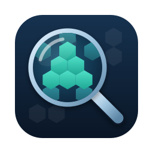
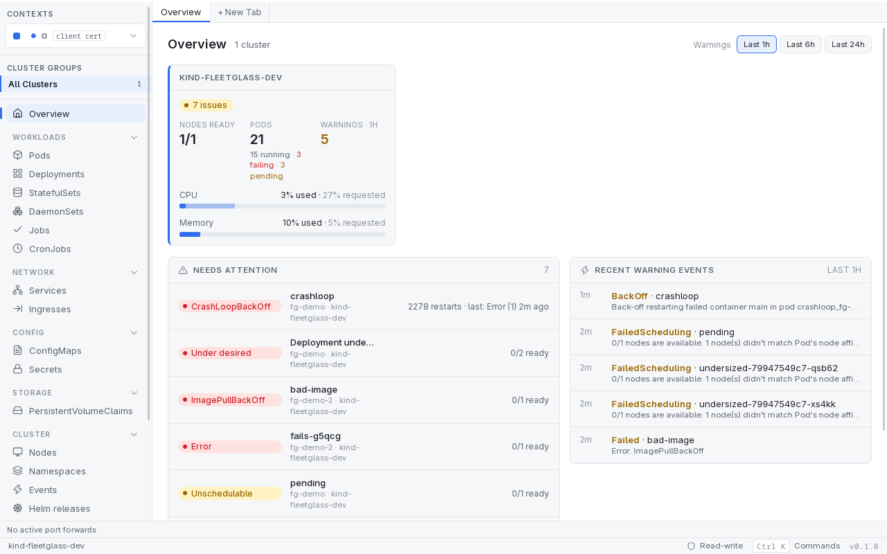

<p align="center">
  
</p>

<h1 align="center">Fleetglass</h1>

<p align="center">
  <b>A fast, keyboard-first Kubernetes desktop app for many clusters at once.</b><br>
  Open source. No account, no telemetry, no AI in the core, no cluster-size limits.
</p>

<p align="center">
  <a href="LICENSE"></a>
  
  
  
</p>

<p align="center">
  
</p>

> [!NOTE]
> **0.4 release.** Tested live on Linux against real clusters and on
> macOS 13 (Intel) and Windows 11. Installers are not code-signed yet, so macOS and Windows warn
> on first launch. Read [Known limitations](docs/KNOWN-LIMITATIONS.md) before relying on it.

## Features

- **Fast on big clusters.** The Rust backend keeps the data; the UI only receives the rows on
  screen. Sorting, filtering and scrolling 50,000 pods stay under 100 ms, checked in CI.
- **Many clusters, one table.** *All Clusters* merges pods from every context, with a Cluster
  column. Clusters connect only when you open them.
- **Keyboard-first.** k9s-style keys (`j`/`k`, `/`, `s`, `r`, `Ctrl+D`) and a `Ctrl+K`
  (`⌘K`) command palette.
- **Safe changes.** Every action shows its `kubectl` command first. Contexts can be colour-coded,
  read-only, or protected (type the name to confirm). A local audit log records what you changed.
- **Honest.** "No permission to list Secrets" instead of an empty list; pod status computed the
  way `kubectl` does.
- **The everyday tools:** live logs with search, a shell into containers, port-forwarding, YAML
  editing with server-side dry-run and diff, scale / restart / delete, Helm releases and
  connection diagnostics.
- **Ecosystem views** for Gateway API, Argo CD, Flux and Karpenter.
- **Yours.** Apache-2.0, DCO sign-off instead of a CLA. The app talks only to your Kubernetes
  API servers.

## Install

Download the installer for your system from
[Releases](https://github.com/TuxoJlumoH/fleetglass/releases):

| System | File | Notes |
|---|---|---|
| Android (10+, API 29+) | `fleetglass-android-arm64-v8a.apk` (phones), `fleetglass-android-x86_64.apk` (emulators) | Standalone APK. See [Android APK verification](docs/VERIFYING_APK.md). |
| Windows 10/11 (x64) | `Fleetglass_<version>_x64-setup.exe` or `.msi` | SmartScreen warns because the installer is unsigned: **More info → Run anyway**. |
| macOS (Intel) | `Fleetglass_<version>_x64.dmg` | Unsigned: right-click the app → **Open** the first time (macOS 15+: **System Settings → Privacy & Security → Open Anyway**). Apple Silicon builds are coming. |
| Linux | build from source for now | Packages (AppImage, deb, rpm, Flatpak, AUR) are planned. |

Fleetglass reads your kubeconfig the same way `kubectl` does (`KUBECONFIG`, or `~/.kube/config`).
It never changes it.

## Build from source

You need Rust (stable), Node.js 24 and pnpm 12, plus the [Tauri system
dependencies](https://tauri.app/start/prerequisites/) for your OS.

```sh
git clone https://github.com/TuxoJlumoH/fleetglass.git
cd fleetglass
scripts/bootstrap.sh --check     # Linux/macOS: checks your toolchain
pnpm -C ui install
pnpm -C ui tauri dev             # run in development mode
pnpm -C ui tauri build           # installers in target/release/bundle/
```

[CONTRIBUTING.md](CONTRIBUTING.md) covers tests, the local `kind` test cluster and Windows/macOS setup.

## Roadmap

Next up for **0.2** ([details](docs/TASKS.md#phase-02-polish-and-missing-basics-planned-2026-11-04)):

- CPU and memory columns in pod and node tables
- Clear status reasons ("Unschedulable", last restart and why)
- YAML editor with line numbers and highlighting
- StatefulSets, DaemonSets, CronJobs, Ingresses, Events and PVCs in the sidebar
- A richer pod summary, a refreshed UI with a light theme, and an overview page
  ([mockups](docs/mockups/v0.2/))
- Signed installers and Apple Silicon builds

Then **0.3: an Android app** ([details](docs/TASKS.md#phase-03-android-app-planned-2026-11-04-starts-after-02-gate)).
It is a standalone app: it connects to your clusters directly, with no server or account. You can
check status, read logs and events, and restart, scale or delete with the same safety checks as on
desktop.

## How it works

```
crates/core   Kubernetes engine: kubeconfig, watch cache, row projection, query engine,
              logs, exec, port-forward, diagnostics (no Tauri dependency)
crates/app    Tauri 2 shell: thin IPC layer over core
crates/bench  performance harness and budgets (kind + kwok)
ui/           React 19 + TypeScript
```

The UI never receives full object lists. It asks the backend for a window of rows (offset, limit,
sort, filter) and gets batched updates. Why: [ADR 0002](docs/adr/0002-data-architecture.md).

## Contributing

Issues and pull requests are welcome. Sign off your commits (`git commit -s`); no CLA. See
[CONTRIBUTING.md](CONTRIBUTING.md), [GOVERNANCE.md](GOVERNANCE.md) and the
[Code of conduct](CODE_OF_CONDUCT.md). Report security problems privately as described in
[SECURITY.md](SECURITY.md).

More docs: [Changelog](CHANGELOG.md) · [Known limitations](docs/KNOWN-LIMITATIONS.md) ·
[Plan](docs/PLAN.md) · [Android verification](docs/VERIFYING_APK.md) · [Architecture ADRs](docs/adr/)

## Licence

[Apache-2.0](LICENSE)
