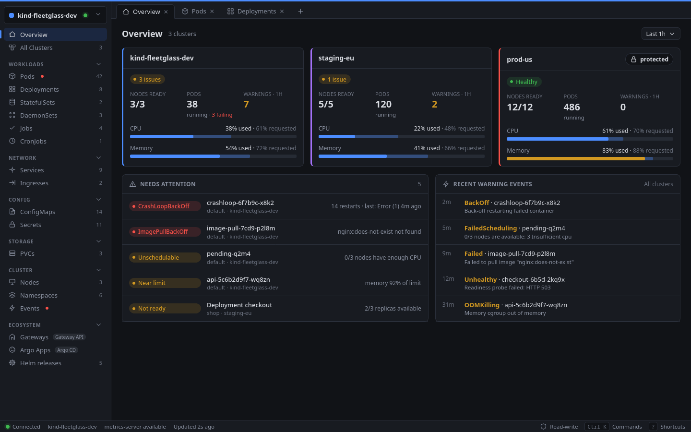
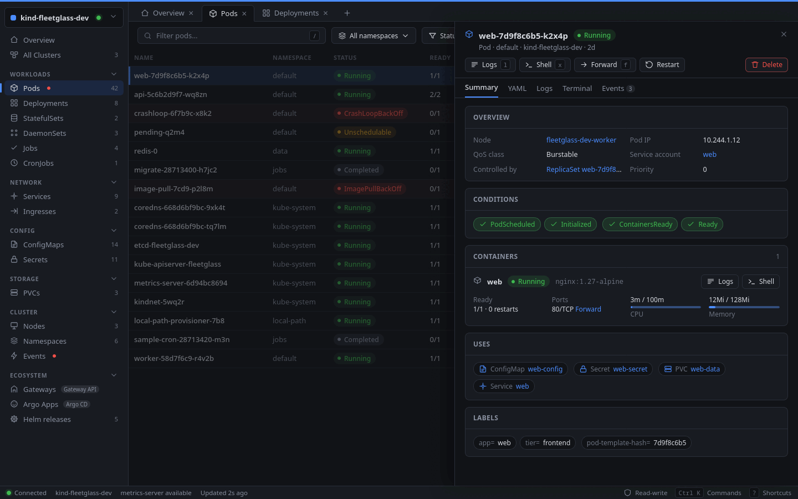
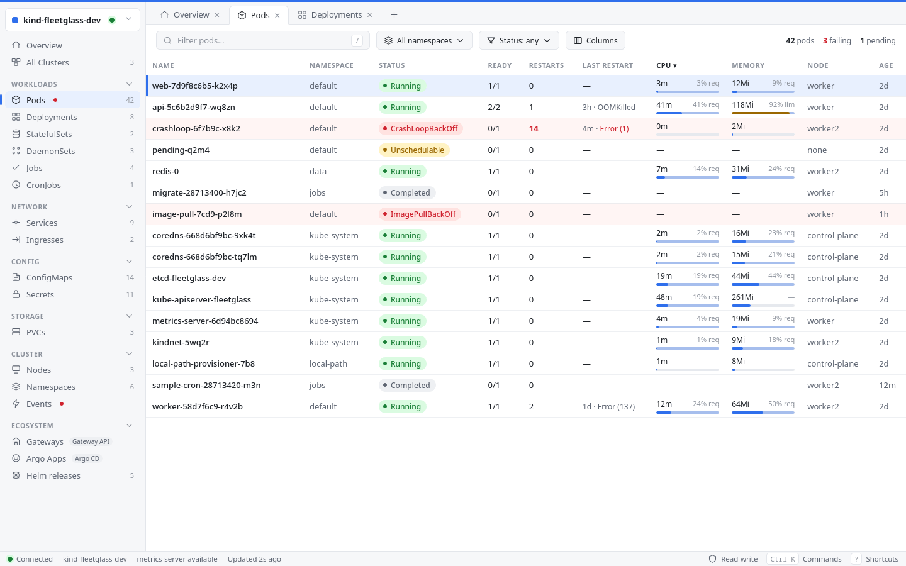
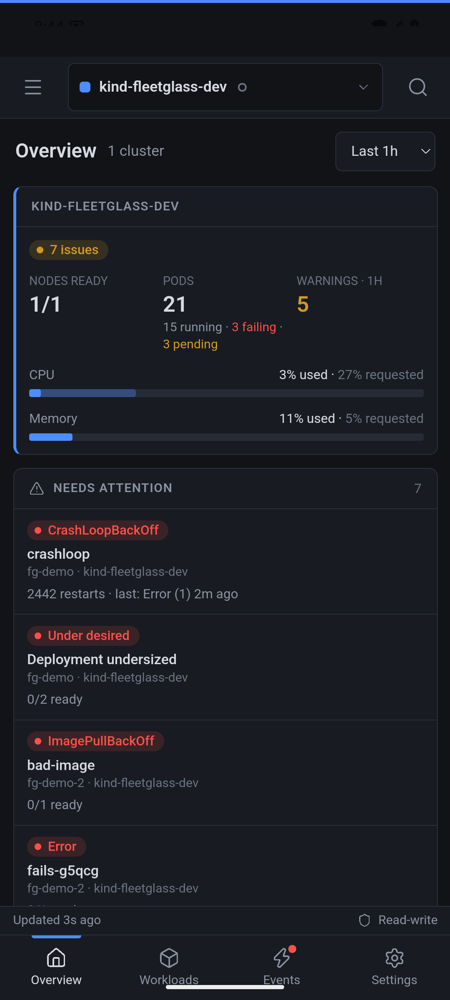
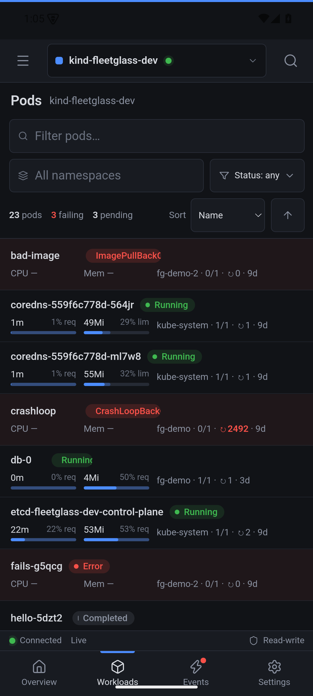
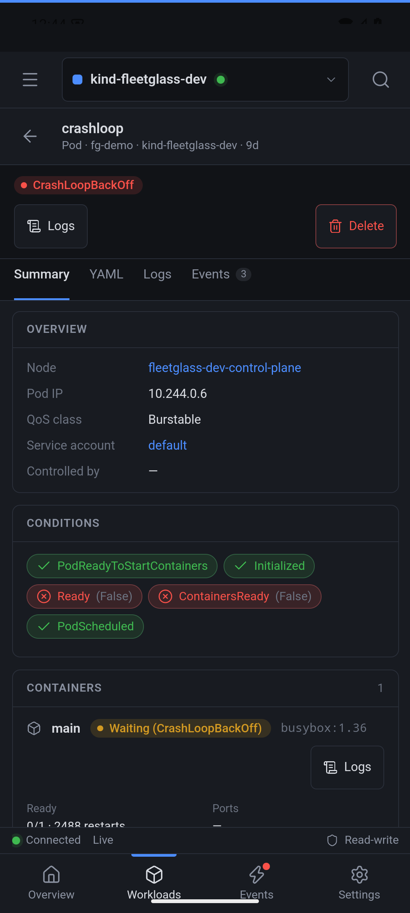
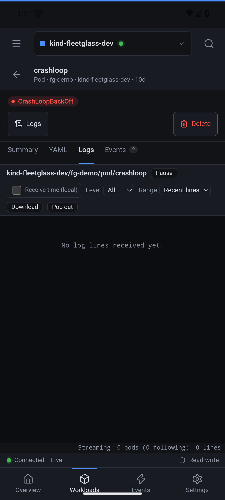

<p align="center">
  
</p>

<h1 align="center">Fleetglass</h1>

<p align="center">
  <b>A fast, keyboard-first Kubernetes client for desktop and mobile.</b><br>
  Open source. Zero telemetry. No account. Offline-first architecture with hardware-backed encryption.
</p>

<p align="center">
  <a href="LICENSE"></a>
  <a href="https://github.com/TuxoJlumoH/fleetglass/releases"></a>
  
  
</p>

<p align="center">
  
</p>

---

## Highlights

- **Blazing fast at scale.** An in-memory Rust query engine projects and window-slices resources. Sorting, filtering, and scrolling across 50,000 pods stays under 50 ms.
- **Simultaneous multi-context exploration.** `Ctrl`/`⌘`+click across any combination of clusters in the sidebar. Merged tables display a pinned, color-coded Context column with independent per-cluster access indicators.
- **Strict write safety & audit trail.** Mutating actions preview their exact `kubectl` command before executing. Protected contexts enforce typed-name confirmation, read-only contexts can be temporarily unlocked for 15 minutes, and all actions are recorded in a local JSONL audit log.
- **Interactive debugging suite.** Launch ephemeral debug containers (`pods/ephemeralcontainers`), attach to PID 1, or start host-namespace Node debug shells (`node/<name>`). Handoff to your favourite native terminal emulator (`ghostty`, `kitty`, `alacritty`, `wezterm`, `iTerm2`, `wt.exe`) with shell-safe escaping.
- **Cloud auth & device code recovery.** Automatically detects expired sessions (`aws sso`, `gcloud`, `az`, `kubelogin`, OIDC), extracts verification URLs and user codes, and triggers seamless cluster reconnection.
- **Resource right-sizing.** Overview analyzes live container metrics against requests and limits to flag Near Limit (≥80%), Over Request (>100%), Unused Requests (<10%, <20%, <50%), and Missing Limits.
- **Standalone Android client.** Direct connection to your API servers with hardware-backed Keystore AES-256-GCM encryption, virtualized pull-to-refresh lists, touch ergonomics, and battery-friendly watcher management.

---

## Desktop Experience

| Multi-Cluster Overview Dashboard | Deep Resource Drawer & Live Inspection |
|:---:|:---:|
|  |  |
| *Cluster capacity, warning events & right-sizing* | *Container metrics, condition chips & safe actions* |

| Crisp Light Theme | Keyboard-First Command Palette |
|:---:|:---:|
|  |  |
| *Semantic tokens following system appearance* | *k9s-style keys (`j`/`k`, `/`, `s`, `r`) & `⌘K` palette* |

---

## Standalone Mobile Client (Android)

Fleetglass runs as a standalone native app on Android (API 29+ / Android 10+). It talks directly to your Kubernetes API servers — no intermediate relay, no cloud backend, and no third-party accounts. Kubeconfigs and credentials are encrypted on-device via the Android Keystore.

<p align="center">
  
  &nbsp;&nbsp;
  
  &nbsp;&nbsp;
  
  &nbsp;&nbsp;
  
</p>

<p align="center">
  <em>Cluster Health Overview · Virtualized Pods with Pull-to-Refresh · Container Details & Safe Actions · Live Log Streaming</em>
</p>

---

## Everyday Tools & Operations

- **Logs & Diagnostics:** Workload and single-pod log streaming, regex search, previous container log recovery, level filters (Error/Warn/Info/Debug), and bounded local export.
- **Arbitrary Compare / Diff:** Side-by-side YAML diffing comparing any two resources across clusters or namespaces with normalization toggles (mask generated hashes/status) and Secret data masking.
- **X.509 Certificate Inspector:** Automatic chain parsing, SAN listing, and validity tracking for TLS Secrets and cert-manager Certificates with expiring alert banners.
- **Port-Forward Manager:** Persistent saved configurations across restarts, live TCP connection counters, byte transfer telemetry, and audit logging.
- **Ecosystem CRD Views:** Built-in projections for Gateway API (`Gateway`, `HTTPRoute`, `GRPCRoute`), Argo CD (`Application`), Flux (`Kustomization`, `HelmRelease`), cert-manager (`Certificate`), and External Secrets (`ExternalSecret`).

---

## Installation

Download pre-built binaries from [Releases](https://github.com/TuxoJlumoH/fleetglass/releases):

| Platform | Package | Notes |
|---|---|---|
| **Android** (10+, API 29+) | `fleetglass-android-arm64-v8a.apk`<br>`fleetglass-android-x86_64.apk` | Standalone client. See [Android Verification Guide](docs/VERIFYING_APK.md). |
| **Linux** | Build from source | Linux packages (Flatpak, AUR, deb, rpm) and ARM64 builds in progress for v0.5. |
| **macOS** (Intel / Apple Silicon) | `Fleetglass_<version>_x64.dmg` | Open via **System Settings → Privacy & Security → Open Anyway** on first launch. |
| **Windows** (10/11 x64) | `Fleetglass_<version>_x64-setup.exe` | SmartScreen warning on first launch: **More info → Run anyway**. |

> [!NOTE]
> Fleetglass loads your kubeconfig read-only (`KUBECONFIG` or `~/.kube/config`). It **never modifies** your original kubeconfig files.

---

## Build from Source

Requirements: Rust (stable), Node.js (v22+), and `pnpm` (v10+).

```sh
# Clone repository
git clone https://github.com/TuxoJlumoH/fleetglass.git
cd fleetglass

# Install UI dependencies & launch desktop dev mode
pnpm -C ui install
pnpm -C ui tauri dev

# Build release desktop bundles
pnpm -C ui tauri build
```

---

## Architecture

Fleetglass uses a split-process architecture designed for zero UI lag:

```
crates/core   Pure Rust Kubernetes engine: kubeconfig parser, reflector caches,
              query engine, streaming logs, exec, port-forward, and audit log.
crates/app    Tauri 2 desktop/mobile application shell with Specta-generated bindings.
crates/bench  Reproducible performance benchmark suite against synthetic & Kind clusters.
ui/           React 19 + TypeScript: virtualized windowed tables, CodeMirror 6 editor.
```

The frontend never receives unbounded JSON payloads; the Rust backend executes windowed queries (`offset`, `limit`, `sort`, `filter`) and pushes minimal diffs.

---

## Roadmap (Phase 0.5 & Beyond)

Next up for **v0.5.0** ([details](docs/PLAN.md#phase-05-distribution-packaging--daily-driver-polish-active-2026-11-13)):

- **Signed In-App Auto-Updater:** `tauri-plugin-updater` with ECDSA signature verification.
- **Expanded Packaging:** Flatpak, AUR (`PKGBUILD`), Homebrew Cask, winget, and Linux ARM64 releases.
- **Per-Namespace Watcher Fallback:** Graceful fallback to watching accessible namespaces on RBAC 403 Forbidden.
- **In-App PTY Terminal:** Embedded `xterm.js` with dynamic PTY window resize signals alongside external terminal handoff.
- **Split View Layout:** Resizable horizontal and vertical split panes for simultaneous side-by-side inspection.
- **Schema Validation & Autocomplete:** Kubernetes OpenAPI JSONSchema diagnostics inside the CodeMirror 6 YAML editor.

---

## Contributing

Contributions are welcome! Please sign off your commits with `git commit -s` (Developer Certificate of Origin; no CLA required).

- Read [CONTRIBUTING.md](CONTRIBUTING.md) for local dev cluster setup and workflow rules.
- Read [GOVERNANCE.md](GOVERNANCE.md) and our [Code of Conduct](CODE_OF_CONDUCT.md).
- Report security concerns responsibly via [SECURITY.md](SECURITY.md).

---

## Licence

[Apache-2.0](LICENSE)
